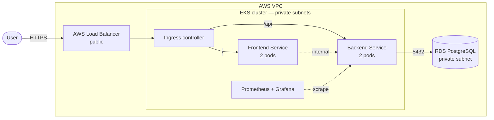

# Kubernetes Platform on AWS

Running a containerized application on Kubernetes — first on a local cluster, then on **AWS EKS** provisioned with **Terraform** — with private networking for the backend and database, packaging with **Helm**, autoscaling, and monitoring with **Prometheus** and **Grafana**.

Project 2 of my [DevOps roadmap](https://github.com/nourseen6/roadmap). The application is the URL shortener from [Project 1](https://github.com/nourseen6/secure-cicd-pipeline); this project runs the image that Project 1's pipeline builds and scans.

> 🚧 **Work in progress.** Each step is tracked as an issue in the [Project 2 milestone](https://github.com/nourseen6/k8s-aws-platform/milestone/1).

## Requirements

- The app runs with **at least two replicas** and recovers on its own when a pod fails.
- Only the entry point is **public**. The backend and the database are reachable only inside the cluster or VPC.
- Secrets are never stored in Git.
- All AWS infrastructure is created with **Terraform** — no manual console changes.
- The app is **monitored**, and an alert fires when something breaks.
- Everything is built and tested on a **local cluster first**. AWS resources are destroyed at the end of each working session to keep costs low.

## Target architecture



| Component | Public? | Why |
|---|---|---|
| Load Balancer | ✅ Yes | The only way in from the internet |
| Ingress controller | No | Routes `/` to the frontend and `/api` to the backend |
| Frontend and backend | No | `ClusterIP` services, reachable only inside the cluster |
| PostgreSQL (RDS) | No | Private subnet; only the backend's security group can connect |

## Plan

| Step | What | Where | Cost |
|---|---|---|---|
| 1 | Local Kubernetes cluster | Laptop | Free |
| 2 | Deploy the app: Deployment with 2 replicas and health probes | Laptop | Free |
| 3 | Expose it with a Service | Laptop | Free |
| 4 | PostgreSQL with a Secret and persistent storage | Laptop | Free |
| 5 | Frontend and Ingress routing | Laptop | Free |
| 6 | Package everything as a Helm chart | Laptop | Free |
| 7 | Terraform: VPC, EKS, and RDS | AWS | Paid by the hour — destroy after each session |
| 8 | Deploy to EKS, and let the pipeline deploy on every release | AWS | Paid |
| 9 | Autoscaling and monitoring with Prometheus and Grafana | Laptop, then AWS | — |
| 10 | Documentation and lessons learned | — | — |

## How the work is done

Every step follows the same workflow:

```
issue → branch → commits → pull request → CI passes → merge → issue closed
```

Nothing is pushed directly to `main`.

## What's built so far

### Local cluster (Step 1)

Docker Desktop's Kubernetes with kind: one node that is both the control plane and the worker.

### The app (Steps 2–3) — [`backend.yaml`](charts/url-shortener/templates/backend.yaml)

- A **Deployment** keeps **2 replicas** of the Project 1 image running. Deleting a pod makes Kubernetes create a new one.
- **Readiness and liveness probes** call `/health`. During a rolling update, an old pod is removed only after its replacement is ready — no downtime.
- **Resource requests and limits** stop one pod from starving the others.
- A **ClusterIP Service** gives the pods one stable name and IP inside the cluster.

### The database (Step 4) — [`postgres.yaml`](charts/url-shortener/templates/postgres.yaml)

- PostgreSQL runs as a **StatefulSet** with a stable pod name (`postgres-0`) and a **1Gi PersistentVolumeClaim**.
- The credentials live in a **Secret** created with `kubectl`, never in Git. The app reads them through `secretKeyRef` and builds `DATABASE_URL` from them.
- An **init container** waits for PostgreSQL before the app starts, so the app doesn't crash-loop after a cluster restart.
- **Tested:** a link created on one replica opens from the other, and it survives deleting the database pod — the new `postgres-0` mounts the same volume.

### Frontend and routing (Step 5) — [`frontend.yaml`](charts/url-shortener/templates/frontend.yaml), [`ingress.yaml`](charts/url-shortener/templates/ingress.yaml)

- The **frontend** is one HTML page stored in a **ConfigMap** and served by the unprivileged nginx image (non-root, 2 replicas). No image to build.
- **Traefik** is the ingress controller, installed with Helm. The community `ingress-nginx` controller was [retired in March 2026](https://www.kubernetes.io/blog/2025/11/11/ingress-nginx-retirement/), so this project uses Traefik, which still supports the standard `Ingress` resource.
- **Routing:** `/` goes to the frontend; `/api/*` goes to the backend, and a Traefik `Middleware` strips `/api`, so `/api/shorten` reaches the API's `/shorten`.
- **Only the ingress controller is exposed.** The frontend, backend, and PostgreSQL Services are all `ClusterIP`.
- **Tested through the Ingress:** the page loads at `/`, `POST /api/shorten` returns a code, and `GET /api/<code>` redirects (307) to the original URL.

### Helm chart (Step 6) — [`charts/url-shortener`](charts/url-shortener)

Steps 2–5 started as plain manifests applied with `kubectl`; they are now one Helm chart, so the whole app installs, upgrades, and rolls back as a single release.

- **[`values.yaml`](charts/url-shortener/values.yaml)** holds what changes between environments: image tags, replicas, resources, and whether PostgreSQL runs in the cluster or an external database (AWS RDS later) is used.
- The backend image is **pinned to a commit tag** (`sha-39dd090`) instead of `latest`, so a deployment is repeatable.
- **Hardened pods.** A Trivy misconfiguration scan found 11 HIGH issues in the first version of the chart: every container ran with the default security context. Now every pod runs as a **non-root user** with the RuntimeDefault seccomp profile, and every container **drops all Linux capabilities**, can't escalate privileges, and has a **read-only root filesystem**.
- **Zero-downtime rollouts.** A `preStop` pause and a Traefik **retry** middleware stop requests from hitting pods that are shutting down. Two rollouts under steady traffic (10 requests per second): **800 of 800 requests succeeded**.
- **Tested:** `helm upgrade` (scale to 3 replicas), a broken release with a bad image tag (the old pods kept serving), and `helm rollback` to the last good revision.
- **CI** ([`chart.yml`](.github/workflows/chart.yml)) runs on every pull request: `helm lint --strict`, rendering with default, monitoring, and external-database values, and a Trivy config scan that fails on HIGH or CRITICAL findings.

### Autoscaling and monitoring (Step 9) — [`hpa.yaml`](charts/url-shortener/templates/hpa.yaml), [`monitoring.yaml`](charts/url-shortener/templates/monitoring.yaml), [`platform/`](platform)

- **metrics-server** reads CPU and memory from the node; `kubectl top` and the autoscaler depend on it.
- A **HorizontalPodAutoscaler** keeps the backend between 2 and 6 replicas, targeting 60% of the CPU request, with a 2-minute scale-down window.
- **kube-prometheus-stack** runs Prometheus, Alertmanager, Grafana, and kube-state-metrics. The Grafana admin password comes from a Secret created with `kubectl` — the chart's default password is public.
- **Traefik's metrics** give request rate, status codes, and latency for every Service, so the app is monitored without changing its code.
- The chart adds a **Grafana dashboard** (requests per second, 5xx ratio, p95 latency, autoscaler replicas, CPU per pod, restarts) and **three alerts**: backend 5xx ratio above 5%, unavailable replicas, and PostgreSQL not ready.
- **Load test** (k6, 60 virtual users for 4 minutes through the ingress): 499,876 requests at about 2,080 per second, **0 failed**, p95 82 ms. The autoscaler went from **2 → 3 → 6** replicas, then back to 2 after the load stopped.
- **Outage test:** with PostgreSQL scaled to 0, `URLShortenerDatabaseDown` and then `URLShortenerHighErrorRate` reached Alertmanager within about 3 minutes. After PostgreSQL came back, new links worked and old links were still there.
- Problems hit on the way: Grafana was **OOMKilled** with a 256Mi memory limit (raised to 512Mi), and Traefik's own `service` metric label is renamed to `exported_service` by Prometheus, so the queries use that.

### Run it

Platform add-ons (values in [`platform/`](platform)):

```bash
helm repo add metrics-server https://kubernetes-sigs.github.io/metrics-server/
helm repo add prometheus-community https://prometheus-community.github.io/helm-charts
helm repo add traefik https://traefik.github.io/charts

helm upgrade --install metrics-server metrics-server/metrics-server --version 3.14.0   -n kube-system -f platform/metrics-server-values.yaml

kubectl create namespace monitoring
kubectl create secret generic grafana-admin -n monitoring   --from-literal=admin-user=admin --from-literal=admin-password="$(openssl rand -hex 16)"
helm upgrade --install monitoring prometheus-community/kube-prometheus-stack --version 92.22.0   -n monitoring -f platform/kube-prometheus-stack-values.yaml

helm upgrade --install traefik traefik/traefik --version 42.3.1   -n traefik --create-namespace -f platform/traefik-values.yaml
```

The app:

```bash
kubectl create namespace dev
kubectl create secret generic postgres-credentials -n dev   --from-literal=POSTGRES_USER=shortener   --from-literal=POSTGRES_PASSWORD="$(openssl rand -hex 16)"   --from-literal=POSTGRES_DB=shortener

helm upgrade --install url-shortener charts/url-shortener -n dev   -f charts/url-shortener/values-local.yaml --wait
```

Open http://localhost — Docker Desktop publishes the Traefik `LoadBalancer` Service on port 80. Or test the API directly:

```bash
curl http://localhost/api/health
```

Grafana (sign in with the user and password from the `grafana-admin` Secret), then open the **URL Shortener** dashboard:

```bash
kubectl port-forward -n monitoring svc/monitoring-grafana 3000:80
```

Upgrade, look at the history, and roll back:

```bash
helm upgrade url-shortener charts/url-shortener -n dev -f charts/url-shortener/values-local.yaml   --set backend.image.tag=sha-39dd090
helm history url-shortener -n dev
helm rollback url-shortener <revision> -n dev
```

> Kubernetes Secrets are base64-encoded, not encrypted. On a real cluster, access to them is limited with RBAC and they are encrypted at rest or kept in a secrets manager.

## License

[MIT](LICENSE)
